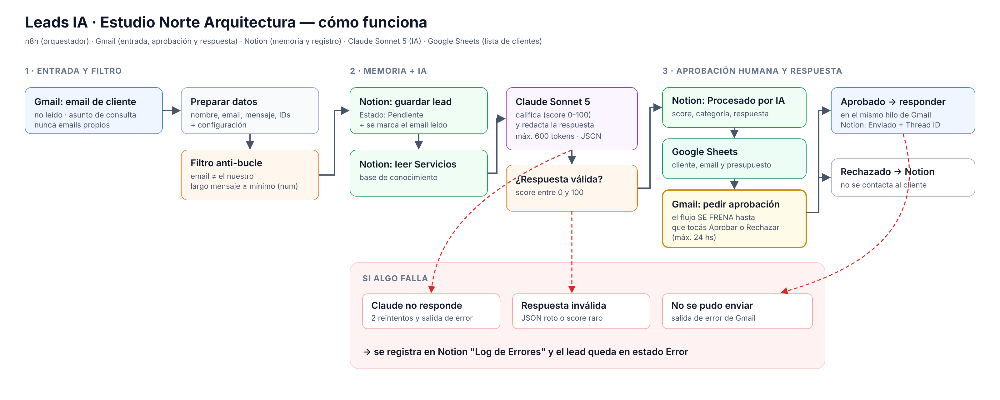

# Leads IA · Estudio Norte Arquitectura

Automatización en **n8n** que gestiona de punta a punta los emails de posibles clientes de un estudio de arquitectura ficticio.

> Llega un email de un posible cliente → se guarda en **Notion** → **Claude** lo califica, detecta el presupuesto y redacta una respuesta con los servicios cargados en Notion → el cliente se suma a **Google Sheets** → el flujo **se frena y pide aprobación por email** → recién con el "Aprobar" se responde al cliente **en el mismo hilo de Gmail**. Si algo falla, queda registrado en Notion.

## Entregables

| Entregable | Archivo / enlace |
|---|---|
| Diagrama de arquitectura (PDF) | [`docs/Diagrama-de-Arquitectura.pdf`](docs/Diagrama-de-Arquitectura.pdf) |
| Lógica del flujo (n8n) | [`workflow/leads-ia-estudio-norte.json`](workflow/leads-ia-estudio-norte.json) |
| Base de datos Notion (solo lectura) | NOTION_LINK |
| Planilla de clientes (Google Sheets) | [Clientes - Estudio Norte](https://docs.google.com/spreadsheets/d/1hVSrCGKFrNnxjVx6uCNp3Q6DJBcaee1APYz65sUc41g/edit) |
| Capturas de evidencia | [`evidencias/`](evidencias/) |

## Tecnologías

| Rol | Tecnología |
|---|---|
| Orquestador | n8n (19 nodos) |
| Base de datos y memoria | Notion: **Leads**, **Servicios** y **Log de Errores**, relacionadas entre sí |
| IA | Claude Sonnet 5 (Anthropic), máximo 600 tokens |
| Entrada, aprobación y salida | Gmail |
| Lista de clientes | Google Sheets |

## Cómo funciona

1. **Gmail Trigger:** cada minuto toma emails no leídos con asunto de consulta, presupuesto, cotización o reforma. Excluye los propios (`-from:me`) y los de aprobación.
2. **Preparar Datos y Configuración:** extrae nombre, email, mensaje e IDs de Gmail, y concentra la configuración en un solo lugar.
3. **Filtro Anti-Bucle:** descarta emails del propio negocio, de aprobación o demasiado cortos.
4. **Notion:** guarda el lead como *Pendiente* y marca el email como leído.
5. **Notion:** lee los servicios activos (base de conocimiento).
6. **Claude:** devuelve JSON con score, categoría, servicio, resumen, si tiene presupuesto y cuánto, y la respuesta.
7. **Validación:** controla que el score sea un número entre 0 y 100 y que haya respuesta.
8. **Notion + Google Sheets:** el lead pasa a *Procesado por IA* y el cliente se agrega a la planilla.
9. **Humano en el loop:** Gmail *Enviar y esperar* manda el borrador con **Aprobar / Rechazar** (espera hasta 24 hs).
10. **Si aprueba:** *Aprobado por Humano* → respuesta en el **mismo hilo** → *Enviado* con el Thread ID. **Si rechaza:** *Rechazado*.
11. **Errores:** fallo de Claude, respuesta inválida o fallo de Gmail → registro en *Log de Errores* y lead en *Error*.

## Check de seguridad

1. **¿Filtro para evitar bucles infinitos?** Sí. Gmail solo toma no leídos y excluye `from:me` y `APROBACION`. El email se marca como leído, y el *Filtro Anti-Bucle* bloquea el email del negocio.
2. **¿Tipos de datos correctos en los filtros?** Sí, con validación estricta: largo del mensaje (número) ≥ mínimo (número), score (número) entre 0 y 100, aprobado (booleano) = verdadero.
3. **¿Prompt dinámico con variables?** Sí. Usa empresa, nombre, asunto y mensaje del cliente, y los servicios leídos de Notion en cada ejecución.

## Evidencia de ejecución en vivo

Ejecución #19 del 10/10/2026, disparada por un email real:

- Email recibido: "Consulta reforma cocina" (cocina de 12 m2, presupuesto USD 8.000).
- Claude: score 90, *Caliente*, servicio *Cocina y baño a medida*.
- Aprobado desde Gmail y respondido en el mismo hilo: Thread ID `1a1274a0eb0c7d4d` de entrada y de salida.
- Notion: lead en estado *Enviado*.

- Link del video de prueba: https://drive.google.com/drive/folders/199abLb6GvCxohovZmcCisiWqX52WfHjd?usp=sharing 

## Cómo importarlo

1. En n8n: **Import from file** → `workflow/leads-ia-estudio-norte.json`.
2. Conectá las credenciales de **Gmail**, **Notion**, **Google Sheets** y **Anthropic**.
3. En el nodo *Preparar Datos y Configuración*, cargá tu email de negocio y el de quien aprueba.
4. Publicá el workflow.
